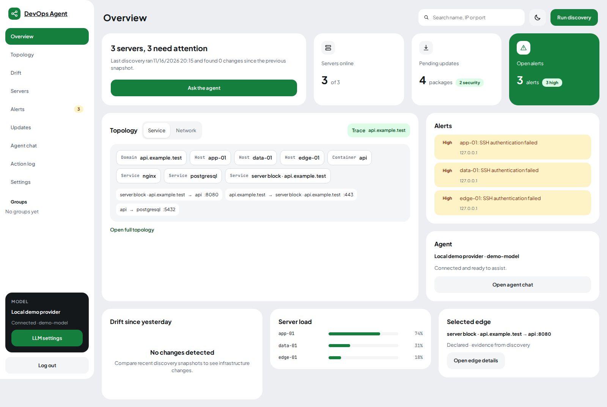
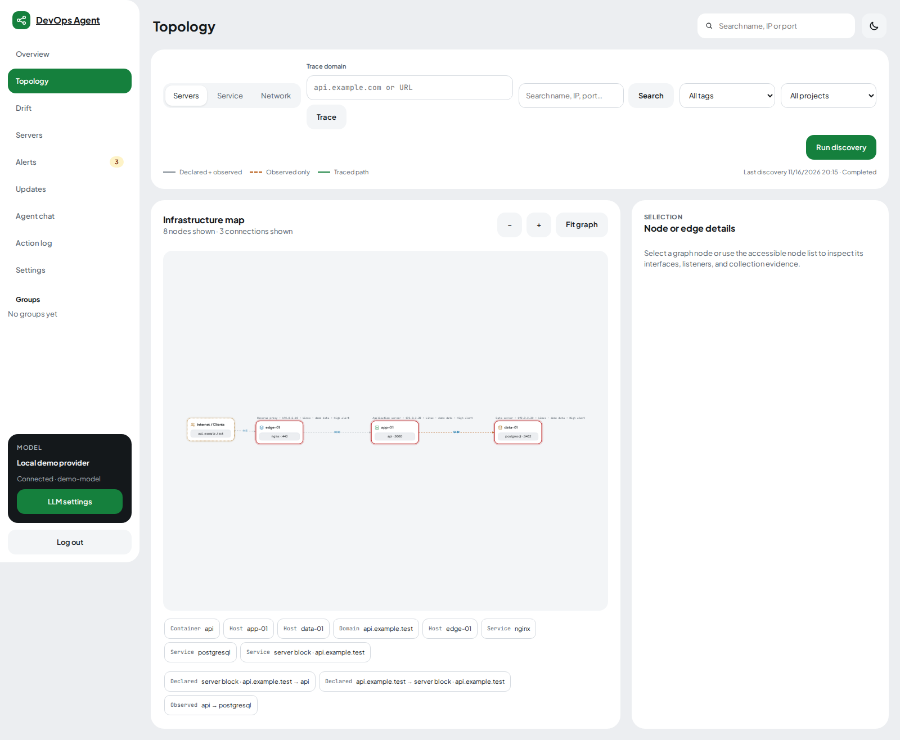
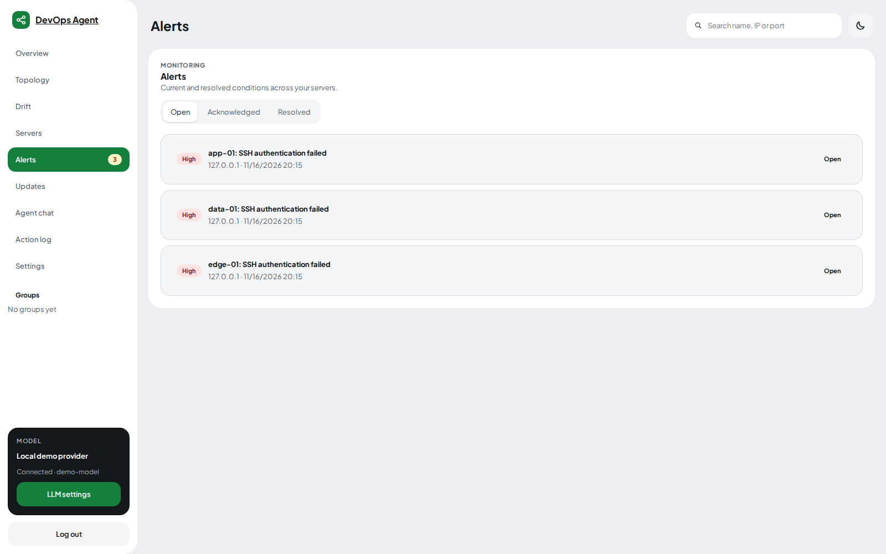
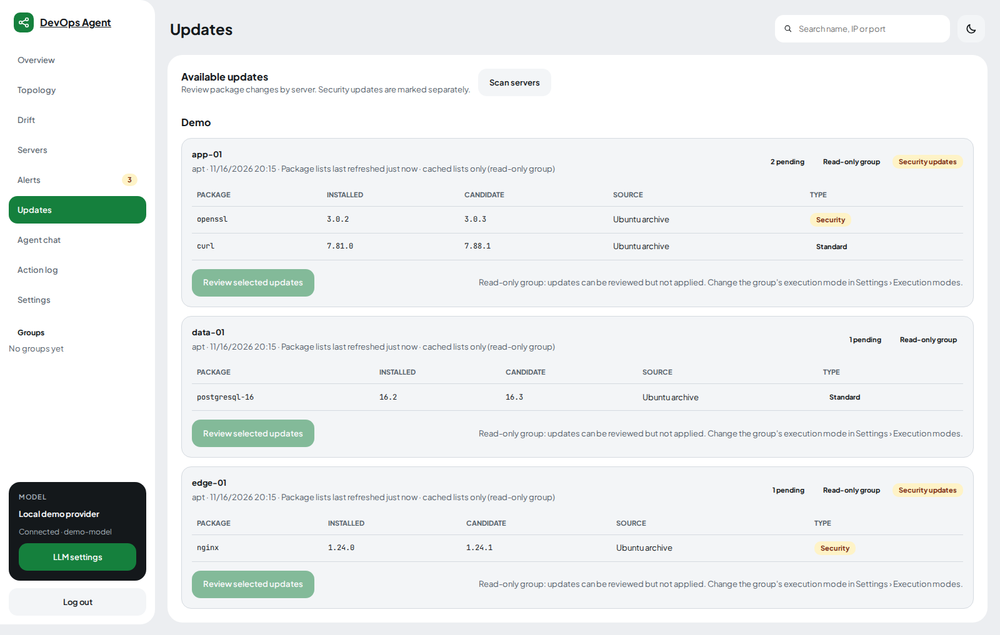

# DevOps Agent

[English](README.md) | فارسی

<p dir="rtl">یک برنامهٔ وب خودمیزبان برای ترسیم نقشهٔ سرورهای لینوکس و ارتباط سرویس‌های آن‌ها، پایش تغییرات و سلامت، بررسی به‌روزرسانی بسته‌ها و کار با یک عامل هوش مصنوعی از طریق SSH. این برنامه برای یک مالک و مدیریت زیرساخت شخصی او طراحی شده است.</p>



<p dir="rtl"><em>صفحهٔ Overview با داده‌های آزمایشی ساختگی. فرایند تهیهٔ تصویر از سرور، حساب کاربری یا ارائه‌دهندهٔ مدل واقعی استفاده نمی‌کند.</em></p>

## قابلیت‌ها

- **فهرست سرورها و اتصال:** نگهداری فهرست سرورها، واردکردن نام‌های میزبان از تنظیمات SSH و اتصال مستقیم یا از طریق سرور واسط (jump host).
- **کشف توپولوژی:** گردآوری اطلاعات میزبان، listenerها، کانتینرها، systemd، nginx و اتصال‌ها با parserهای قطعی. مشاهدهٔ نقشه‌های سرور، سرویس و شبکه؛ ردیابی یک دامنه و بررسی شواهد هر اتصال.
- **پایش و بررسی:** مقایسهٔ snapshotهای کشف برای یافتن تغییرات، مشاهدهٔ معیارهای سرور و بررسی سلامت، هشدارها و به‌روزرسانی بسته‌ها؛ همچنین ارسال اعلان هشدار از طریق ntfy یا Telegram.
- **عامل هوش مصنوعی با تأیید کاربر:** اتصال به Ollama، LM Studio، OpenRouter یا هر endpoint سازگار با OpenAI. عامل می‌تواند از ابزارهای DevOps برنامه استفاده کند؛ تغییرهای پیشنهادی در رابط کاربری بررسی می‌شوند و اجرای آن‌ها تابع سیاست فقط‌خواندنی یا تأیید هر تغییر برای گروه سرور است.
- **تاریخچهٔ عملیات:** بررسی عملیات پیشنهادی و انجام‌شده در بخش Action log.

## تصاویر

### نقشهٔ زیرساخت



<p dir="rtl"><em>این نقشه سرویس‌ها را بر اساس سرور گروه‌بندی می‌کند و پورت اتصال‌ها را نشان می‌دهد.</em></p>

### هشدارها



<p dir="rtl"><em>این هشدارها از فهرست آزمایشی ساختگی و بدون کلید SSH ساخته شده‌اند.</em></p>

### به‌روزرسانی بسته‌ها



<p dir="rtl"><em>نام بسته‌ها، نسخه‌ها، نام سرورها و جزئیات هشدار در این تصاویر ساختگی هستند.</em></p>

## فناوری‌ها

- .NET 10 و ASP.NET Core با Blazor Web App و رندر Interactive Server
- SQLite با migrationهای EF Core
- SSH.NET برای اتصال‌های SSH
- Microsoft.Extensions.AI با endpointهای مدل سازگار با OpenAI
- Cytoscape.js و ELK برای نقشه‌های تعاملی توپولوژی
- Docker Compose برای برنامهٔ کانتینری و سرویس اختیاری Ollama

<p dir="rtl">برنامهٔ وب، سرویس‌های پس‌زمینهٔ پایش، پایگاه دادهٔ SQLite و مخزن اتصال‌های SSH در یک فرایند اجرا می‌شوند. دسترسی به زیرساخت از طریق SSH و به‌وسیلهٔ خود برنامه انجام می‌شود. endpoint داخلی Compose از HTTP استفاده می‌کند؛ آن را فقط در شبکهٔ مورد اعتماد قرار دهید یا پیش از ارسال اطلاعات ورود از reverse proxy با خاتمهٔ TLS استفاده کنید.</p>

## اجرای سریع با Docker Compose

<p dir="rtl">پیش‌نیاز: Docker Engine به‌همراه افزونهٔ Compose نسخهٔ ۲. برای مدیریت سرورها، دسترسی SSH و کلید خصوصی هر مقصد نیز لازم است. ارائه‌دهندهٔ مدل اختیاری است و فقط برای استفاده از Agent chat نیاز می‌شود.</p>

۱. پوشه‌های داده و کلید را بسازید و فایل نمونهٔ متغیرهای محیطی را کپی کنید:

```bash
mkdir -p data keys
chmod 700 keys
cp .env.example .env
```

۲. فایل `.env` را ویرایش کنید. مقدارهای `ADMIN_USER` و برای اجرای محلی `ADMIN_PASSWORD` را تعیین کنید (یا `ADMIN_PASSWORD_HASH` را بگذارید) و `DVA_UID` و `DVA_GID` را با شناسهٔ عددی کاربر و گروهی که مالک `./data` هستند تنظیم کنید. فایل `.env` را commit نکنید.

۳. فایل‌های کلید SSH را در `./keys` کپی کنید، دسترسی آن‌ها را محدود کنید و برنامه را اجرا کنید:

```bash
chmod 600 keys/your_private_key
docker compose up --build -d
```

۴. [http://localhost:8080](http://localhost:8080) را باز کنید و با اطلاعات ورود مدیر پیکربندی‌شده وارد شوید. یک گروه و سرور اضافه کنید، کلید SSH را انتخاب کنید، اتصال را آزمایش کنید و از **Topology** فرایند کشف را اجرا کنید.

<p dir="rtl">پایگاه دادهٔ SQLite و کلیدهای Data Protection در `./data` ذخیره می‌شوند. پوشهٔ `./keys` به‌صورت فقط‌خواندنی و در مسیر `/keys` به کانتینر متصل است. از `./data` به‌طور امن نسخهٔ پشتیبان تهیه کنید و فایل `.env` و کلیدهای SSH را محرمانه نگه دارید.</p>

### سرویس اختیاری Ollama

برنامه را با profile به‌نام `ollama` در Compose اجرا کنید:

```bash
docker compose --profile ollama up --build -d
```

<p dir="rtl">سپس در **Settings → LLM connection** یک ارائه‌دهندهٔ Ollama اضافه کنید. وقتی برنامه و Ollama در همین پروژهٔ Compose اجرا می‌شوند، آدرس پایهٔ ارائه‌دهنده را `http://ollama:11434/v1` بگذارید و یک مدل موجود را انتخاب کنید.</p>

## اعتماد SSH و حالت‌های اجرا

<p dir="rtl">در نخستین اتصال موفق SSH به هر سرور، برنامه کلید میزبان ارائه‌شده را ثبت می‌کند (اعتماد در نخستین استفاده). اثرانگشت نمایش‌داده‌شده را با منبعی مستقل بررسی کنید. کلید تغییرکرده پذیرفته نمی‌شود و هشدار می‌سازد؛ جایگزینی آن در صفحهٔ سرور به تأیید نیاز دارد. می‌توانید با فایل `known_hosts` تحت مدیریت خود نیز کلیدها را پین کنید.</p>

<p dir="rtl">گروه‌های جدید سرور به‌طور پیش‌فرض روی حالت **Read-only** هستند. در حالت **Confirm** نیز تغییرها پیش از اجرا نیاز به بررسی و تأیید دارند. ابتدا با دسترسی فقط‌خواندنی شروع کنید و فهرست کشف‌شده را بررسی کنید؛ سپس در صورت نیاز عملیات را فعال کنید. برنامه اعتبارنامه‌های SSH و ارائه‌دهندهٔ مدل را نگه می‌دارد؛ آن را در شبکهٔ خصوصی یا پشت TLS درست پیکربندی‌شده اجرا کنید و endpoint داخلی HTTP را مستقیم در اینترنت عمومی قرار ندهید.</p>

## توسعهٔ محلی

<p dir="rtl">پیش‌نیاز: .NET 10 SDK. پروفایل توسعه با آدرس `http://localhost:5154` اجرا می‌شود و داده‌های محلی برنامه را در `src/DevOpsAgent.Web/data` نگه می‌دارد.</p>

متغیرهای ورود محلی را تنظیم و برنامه را اجرا کنید:

```bash
export ADMIN_USER=admin
export ADMIN_PASSWORD='replace-with-a-local-password'
dotnet run --project src/DevOpsAgent.Web
```

ساخت و اجرای مجموعهٔ آزمون‌ها:

```bash
dotnet build DevOpsAgent.slnx
dotnet test DevOpsAgent.slnx
```

## به‌روزرسانی تصاویر

<p dir="rtl">تصاویر با Playwright و Chromium از برنامهٔ در حال اجرا گرفته می‌شوند. اسکریپت تهیهٔ تصویر یک پایگاه دادهٔ موقت و تازهٔ SQLite می‌سازد، فقط داده‌های ساختگی وارد می‌کند، برنامه را روی loopback اجرا می‌کند، با اعتبارنامهٔ آزمایشی موقت وارد می‌شود و چهار تصویر PNG را در `docs/screenshots/` می‌نویسد. مسیر کلید SSH آزمایشی وجود ندارد و هیچ کلید واقعی استفاده نمی‌شود. با پایان اسکریپت، پایگاه دادهٔ موقت و مواد کلید آن حذف می‌شوند.</p>

<p dir="rtl">پیش‌نیاز: .NET 10 SDK، ‏Node.js نسخهٔ ۲۰ یا جدیدتر، npm و کتابخانه‌های سیستمی Chromium که Playwright در سیستم‌عامل شما نیاز دارد.</p>

```bash
npm ci
npx playwright install chromium
npm run docs:screenshots
```

<p dir="rtl">Seeder در `tools/DevOpsAgent.DocsDemo/` قرار دارد؛ فقط برای مستندات است و بخشی از solution یا runtime برنامه نیست. دستور تهیهٔ تصاویر در این مخزن با موفقیت اجرا شده است. مسیر اجرای Docker Compose در همین به‌روزرسانی مستندات آزمایش نشده است.</p>

## endpoint سلامت

<p dir="rtl">`GET /healthz` وضعیت سلامت و نسخهٔ برنامه را بدون نیاز به ورود برمی‌گرداند.</p>

## مجوز

<p dir="rtl">فایل ریشه‌ای `LICENSE` پیدا نشد. در این مستند مجوز یا اجازه‌ای برای استفادهٔ مجدد از پروژه اعلام نشده است.</p>
