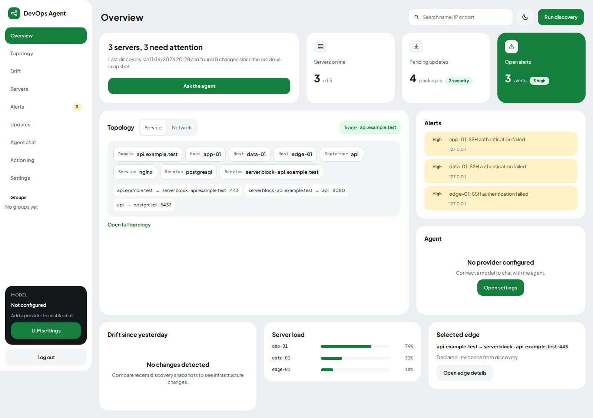
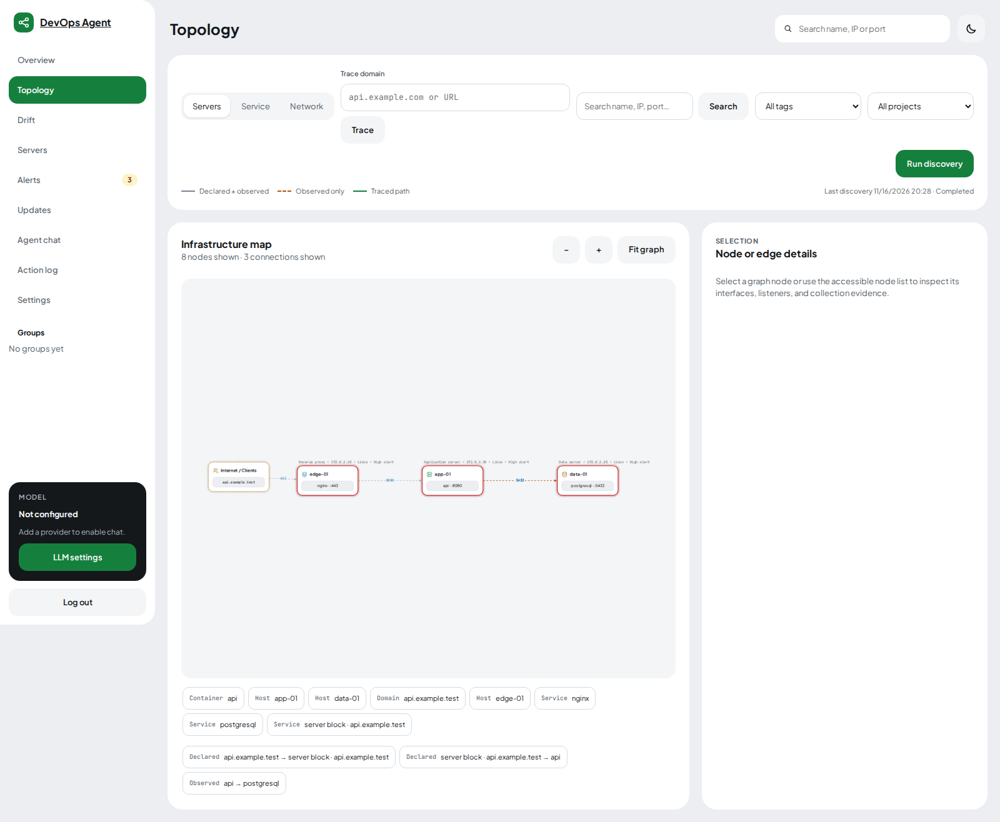
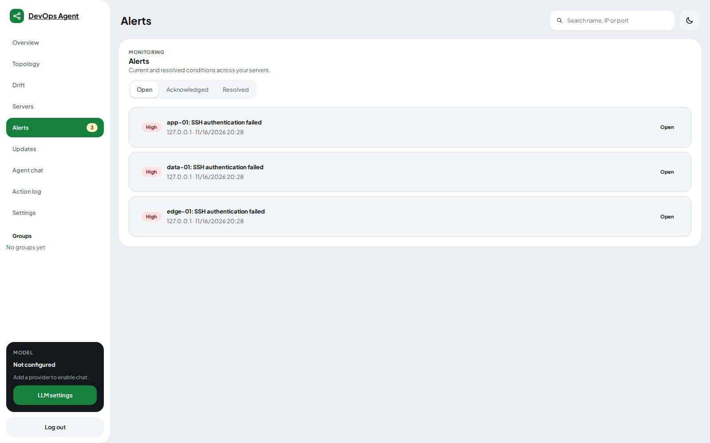
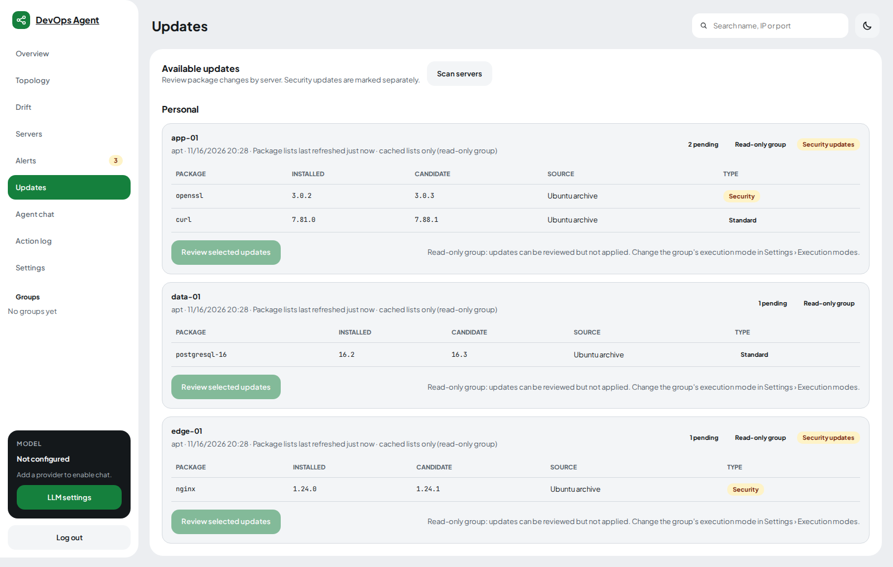

# DevOps Agent

English | [فارسی](README.fa.md)

A self-hosted web app for mapping Linux servers and their service connections, monitoring changes and health, reviewing package updates, and working with an AI agent over SSH. It is designed for one owner managing their own infrastructure.



*Overview of the server map, monitoring summary, and open alerts.*

## What it does

- **Inventory and connect:** keep a server inventory, import SSH host aliases, and connect directly or through a jump host.
- **Discover topology:** collect host, listener, container, systemd, nginx, and connection data with deterministic parsers. Browse server, service, and network maps; trace a domain and inspect the evidence for a connection.
- **Monitor and review:** compare discovery snapshots for drift, view server metrics and health checks, review alerts and package updates, and send alert notifications through ntfy or Telegram.
- **Use an AI agent with approvals:** connect Ollama, LM Studio, OpenRouter, or another OpenAI-compatible endpoint. The agent can use the app's DevOps tools; proposed changes are reviewed in the UI and actions follow each server group's read-only or confirm policy.
- **Keep an action history:** inspect proposed and completed actions in the Action log.

## Screenshots

### Infrastructure map



*The map groups services by server and labels connections with their ports.*

### Alerts



*Alerts identify the affected server and the authentication status.*

### Package updates



*The Updates page groups pending packages by server and marks security updates.*

## Technology

- .NET 10 and ASP.NET Core with a Blazor Web App using Interactive Server rendering
- SQLite with EF Core migrations
- SSH.NET for SSH connections
- Microsoft.Extensions.AI with OpenAI-compatible model endpoints
- Cytoscape.js and ELK for interactive topology maps
- Docker Compose for the containerized app and optional Ollama service

The web app, background monitoring services, SQLite store, and SSH connection pool run in one application process. Infrastructure access is initiated by the app over SSH. The app's built-in Compose endpoint uses HTTP; keep it on a trusted network or put it behind a TLS-terminating proxy before sending credentials over an untrusted network.

## Quick start with Docker Compose

Requirements: Docker Engine with the Compose v2 plugin. To manage servers, also have SSH access and a private key for each target. An LLM provider is optional and is needed only for Agent chat.

1. Create the local data and key folders and copy the environment template:

   ```bash
   mkdir -p data keys
   chmod 700 keys
   cp .env.example .env
   ```

2. Edit `.env`. Set `ADMIN_USER`, set `ADMIN_PASSWORD` for a local setup (or provide `ADMIN_PASSWORD_HASH`), and set `DVA_UID` and `DVA_GID` to the numeric ID and group ID of the account that owns `./data`. Do not commit `.env`.

3. Copy SSH identity files into `./keys`, restrict their permissions, then start the app:

   ```bash
   chmod 600 keys/your_private_key
   docker compose up --build -d
   ```

4. Open [http://localhost:8080](http://localhost:8080) and sign in with the configured admin credentials. Add a server group and server, choose the SSH identity, test the connection, and run discovery from **Topology**.

The SQLite database and data-protection keys are stored under `./data`. The `./keys` directory is mounted read-only into the app container at `/keys`. Back up `./data` securely; protect the SSH keys and `.env` as secrets.

### Optional local Ollama service

Start the app with the Compose `ollama` profile:

```bash
docker compose --profile ollama up --build -d
```

Then add an Ollama provider in **Settings → LLM connection**. When the app and Ollama run in this Compose project, use `http://ollama:11434/v1` as the provider base URL and select an available model.

## SSH trust and operation modes

On a server's first successful SSH connection, the app records the presented host key (trust on first use). Check the displayed fingerprint against a trusted source. A changed key is refused and raises an alert; accepting a replacement requires confirmation in the server page. An owner-managed `known_hosts` file can also pin keys.

New server groups default to **Read-only**. In **Confirm** mode, changes still require review and approval in the app. Start with read-only access and review the discovered inventory before enabling actions. The app stores SSH and model-provider credentials, so keep it behind a private network or a properly configured TLS proxy; do not expose the built-in HTTP endpoint directly to the public internet.

## Sudo on managed servers

The recommended setup for managed Linux hosts is a dedicated SSH user (for example `devops`) with a restricted `NOPASSWD` sudoers drop-in at `/etc/sudoers.d/devops-agent` instead of unrestricted `ALL` access. DevOps Agent's built-in sudo monitor (`AppSudoCommands`) exempts only the app's own commands and still raises an alert for any unexpected sudo invocation by that user.

For read-only discovery, monitoring, and security audits, start with the minimal pinned profile below (replace `devops` with your SSH user):

```sudoers
# /etc/sudoers.d/devops-agent
Defaults:devops !requiretty, use_pty

Cmnd_Alias DVA_DISCOVERY = /usr/bin/true, \
    /usr/bin/ss -tulpnH, \
    /usr/bin/ss -tnpH, \
    /usr/bin/netstat -tulpn, \
    /usr/sbin/nginx -T, \
    /usr/bin/docker info --format *, \
    /usr/bin/docker ps -a *, \
    /usr/bin/docker network ls *, \
    /usr/bin/docker inspect *, \
    /usr/bin/nsenter -t [0-9]* -n /usr/bin/ss -tnpH

Cmnd_Alias DVA_MONITORING = /usr/bin/journalctl -u ssh*, \
    /usr/bin/systemctl --failed --type=service --no-legend --plain, \
    /usr/bin/df -P *, \
    /usr/bin/du -x -h --max-depth=1 *

Cmnd_Alias DVA_SECURITY = /usr/sbin/sshd -T, \
    /usr/sbin/ufw status, \
    /usr/sbin/nft list ruleset, \
    /usr/sbin/iptables -S, \
    /usr/bin/fail2ban-client status*

devops ALL=(root) NOPASSWD: DVA_DISCOVERY, DVA_MONITORING, DVA_SECURITY
```

To allow approved mutating actions (package updates, service restarts, firewall bans, or validated config edits via a root-owned helper script `/usr/local/sbin/dva-sudo-helper`), generate an extended profile with `SudoersProfileGenerator` and add only the command aliases needed by that server's group. Always validate before saving:

```bash
sudo chmod 0440 /etc/sudoers.d/devops-agent
sudo visudo -cf /etc/sudoers.d/devops-agent
```

## Local development

Requirements: .NET 10 SDK. The development launch profile uses `http://localhost:5154` and stores local app data under `src/DevOpsAgent.Web/data`.

Set local login credentials and run the app:

```bash
export ADMIN_USER=admin
export ADMIN_PASSWORD='replace-with-a-local-password'
dotnet run --project src/DevOpsAgent.Web
```

Build and run the test suite with:

```bash
dotnet build DevOpsAgent.slnx
dotnet test DevOpsAgent.slnx
```

## Refreshing the screenshots

The screenshots are captured from the running app with Playwright and Chromium. The capture script creates a temporary SQLite database, starts the app on loopback, signs in with a temporary local credential, and writes the four PNGs in `docs/screenshots/`. It does not connect to an external server or model provider, and it removes its temporary files when it exits.

Requirements: .NET 10 SDK, Node.js 20 or later, npm, and the Chromium libraries required by Playwright on your operating system.

```bash
npm ci
npx playwright install chromium
npm run docs:screenshots
```

The seeder is in `tools/DevOpsAgent.DocsDemo/`; it is documentation-only and is not part of the application solution or runtime. The screenshot command was run successfully in this repository. The Docker Compose quick start was not exercised as part of this documentation update.

## Health endpoint

`GET /healthz` returns the app's health status and version without requiring a login.

## License

This project is licensed under the [MIT License](LICENSE).
